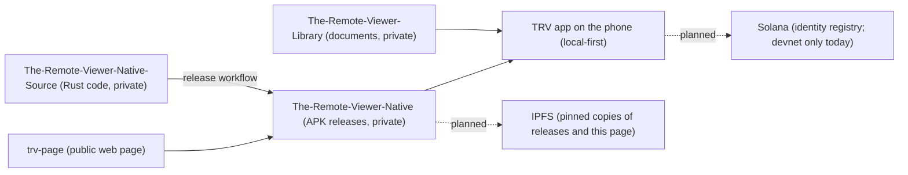

# trv-page

Public repository for the static web page of The Remote Viewer (TRV), served by GitHub Pages at https://sentinel-architech.github.io/trv-page/.

- Visibility: public.
- Contents: a single `index.html`, `SECURITY.md`, CODEOWNERS (after its PR), and CI workflows (HTML check, gitleaks secret scan, CodeQL, actionlint).
- Licence: none applied yet. AGPL-3.0 is planned but has not been applied.

## How it fits together

Solid lines exist today. Dotted lines are plans, not live yet. Details: `docs/DECENTRALIZATION.md` in The-Remote-Viewer-Native-Source.
